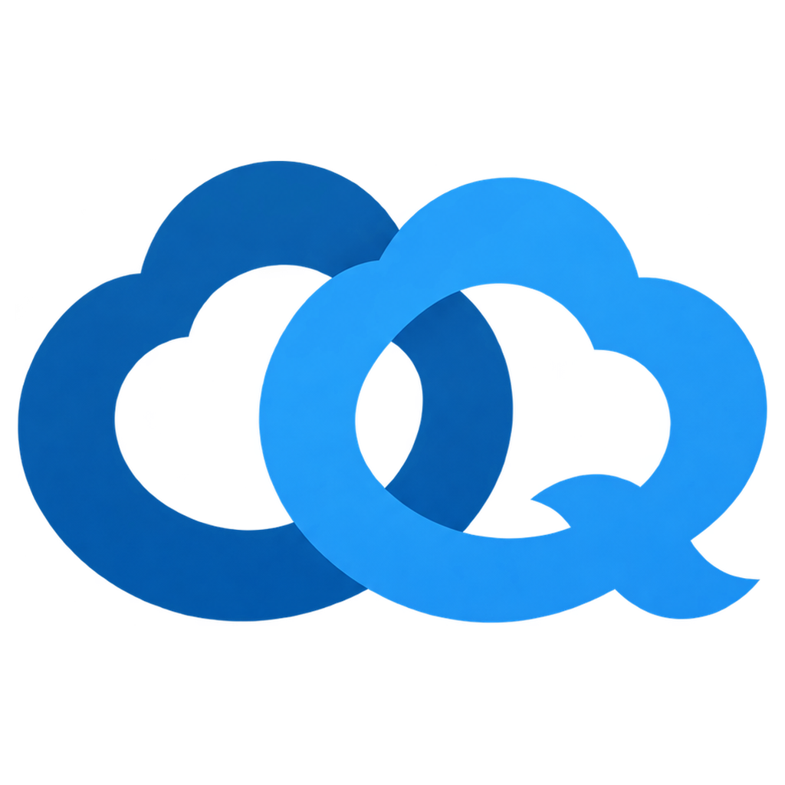
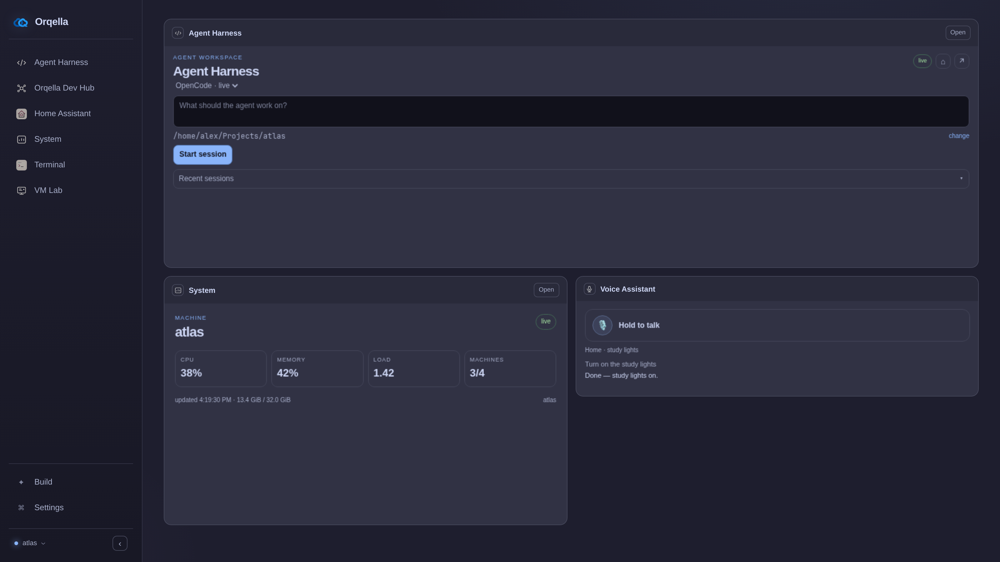
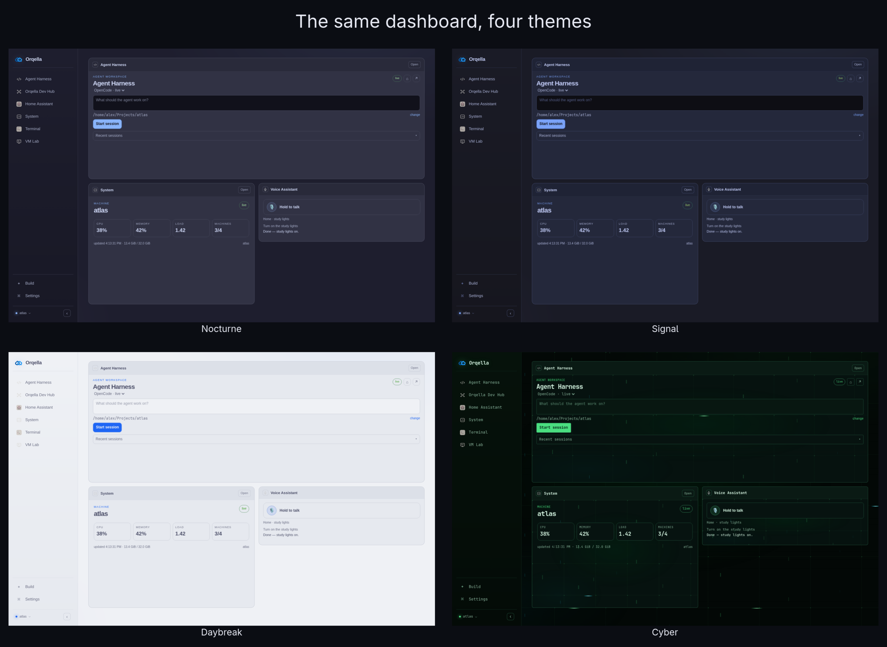

<p align="center">
  <a href="https://orqella.io">
    
  </a>
</p>

<h1 align="center">Orqella</h1>

<p align="center">
  <strong>Build with your agent. Reach it anywhere.</strong><br>
  A local-first app platform with encrypted peer-to-peer access.
</p>

<p align="center">
  <a href="https://orqella.io">Website</a> ·
  <a href="#quick-start">Quick start</a> ·
  <a href="#modules">Modules</a> ·
  <a href="#desktop-client">Desktop client</a> ·
  <a href="docs/">Documentation</a>
</p>

Orqella by itself is a blank slate. When installed locally with no modules, it
can't do much. The two ideas that matter most:

- **Your agent can build the app.** A module is a self-contained package with a
  frontend and an optional sidecar that runs on your device. Ask your configured
  agent for a page, and Orqella validates and installs the module. The Agent
  Harness module also gives ACP agents such as Claude Code, Codex, Gemini CLI,
  and OpenCode one workspace for sessions, approvals, plans, and diffs.
- **Reach is peer-to-peer.** The Orqella Link service signs devices in and helps
  them find each other, then gets out of the way. The dashboard and app traffic
  use authenticated SSH over iroh/QUIC, established with UDP hole punching and
  encrypted end to end. This works from a browser, a mobile app, a desktop app,
  or another Orqella instance. It does not require router port forwarding in the
  common case; on a host with an active firewall, allow Orqella's Link UDP port
  from the LAN (`orqella firewall install`). SSH is never sent over a relay. It
  does not require sshd or an equivalent SSH service.

## Screenshots

<p align="center">
  <a href="docs/screenshots/dashboard.png"></a>
</p>

<p align="center">
  <a href="docs/screenshots/themes.png"></a>
</p>

<p align="center">
  <a href="docs/screenshots/settings.png">Module settings</a> ·
  <a href="docs/screenshots/system.png">System module</a>
</p>

## Install

On Linux and macOS, one command installs the daemon, CLI, desktop app, and
per-user service:

```bash
curl -fsSL https://orqella.io/install.sh | sh
```

The installer verifies the published SHA-256 checksums, does not use `sudo`,
and does not need Rust, Git, or a source checkout. It also installs the Agent
Harness workspace, connects any OpenCode, Claude Code, Codex, or Gemini CLI
already on the machine, installs the Orqella agent skill for coding agents, and
offers to install OpenCode with a free default model when no coding agent is
found. Skip the module with `--no-agent-harness`; decline OpenCode with
`--no-opencode`.

On Windows, download the Orqella setup from <https://orqella.io/#download>; it
installs the daemon, CLI, desktop app, and startup entry together. The
components page includes the Agent Harness workspace and an optional OpenCode
install.

Open <http://orqella.localhost:9477/> after the installer finishes. To review
the resolved versions and URLs first, add `--dry-run`:

```bash
curl -fsSL https://orqella.io/install.sh | sh -s -- --dry-run
```

Manual archives remain available on
[GitHub Releases](https://github.com/orqella/orqella/releases). Each archive
contains the `orqella` binary, README, license, changelog, and an SBOM. Verify
the archive against `SHA256SUMS.txt`, extract it, then run:

```bash
./orqella setup
./orqella serve
```

`setup` installs Agent Harness, connects a coding agent, and installs the
Orqella agent skill for local agents. It restarts the managed service
automatically; stop a manual `serve` first.

To install the per-user service from a manual archive:

```bash
./orqella service install
./orqella open
```

Installed releases update from GitHub:

```bash
orqella update check
orqella update apply
```

The updater selects the archive for the current platform, verifies its SHA-256
checksum, replaces the binary, refreshes the Orqella agent skill, and restarts
the service. It does not require a git checkout or Rust.

The release archives include Linux, macOS (Intel and Apple Silicon), and Windows
builds. The installers in this repository build from source and are intended for
development; the prebuilt binaries do not require Rust.

## Building from source

Requirements: [Rust](https://rustup.rs/) stable, Git, and Python 3.11+ if you
plan to use modules with Python sidecars. Linux, macOS, and Windows are
supported.

```bash
git clone https://github.com/orqella/orqella.git
cd orqella
cargo build --release
./target/release/orqella serve
```

Open **http://orqella.localhost:9477/**.

If you prefer the numeric loopback address, **http://127.0.0.1:9477/** serves
the same dashboard.

### Install as a user service

```bash
cargo install --path . --locked
orqella service install
orqella open
```

This installs the per-user service (systemd on Linux, a LaunchAgent on macOS, or
a startup entry on Windows) and starts Orqella at login.

To install or repair the default Agent Harness workspace by hand, stop the
daemon and run:

```bash
orqella setup                    # install the module and connect an existing agent
orqella setup --install-opencode # install OpenCode and select a free model
orqella setup --status --json    # inspect detection without changing anything
```

Platform installers that build, install, register the service, and start it are
also available for development:

```bash
./install-linux.sh
./install-macos.sh
```

```powershell
.\install-windows.ps1
```

The installers ask once to add the LAN-scoped Link firewall rule, and they run
the same agent workspace setup as the prebuilt installer. Use `--firewall` or
`--no-firewall` for unattended Linux/macOS installs, and `-Firewall` or
`-NoFirewall` on Windows. Use `--no-agent-harness`, `--opencode`, and
`--no-opencode` (or the Windows switches `-NoAgentHarness`, `-InstallOpenCode`,
and `-NoOpenCode`) to control the agent setup.

On macOS, Chrome, Firefox, and the desktop client need no extra setup. Safari does not resolve `*.localhost` through the system resolver; if you want the canonical `orqella.localhost` URL and full app surfaces in Safari, run `orqella hosts install` once. The dashboard also works directly at `http://127.0.0.1:9477/`.

### Configuration

Orqella creates its config on first run:

| Platform | Config | Data |
| --- | --- | --- |
| Linux | `~/.config/orqella/config.toml` | `~/.local/share/orqella/` |
| macOS | `~/Library/Application Support/orqella/` | `~/Library/Application Support/orqella/` |
| Windows | `%APPDATA%\orqella\` | `%LOCALAPPDATA%\orqella\` |

Set `ORQELLA_HOME` for a portable layout with `config/`, `data/`, and `run/`
under one directory.

## Modules

First-party modules for **System**, **OpenCode**, **VM Lab**, **Voice
Assistant**, **Terminal**, and **Home Assistant** are published under the
[orqella organization](https://github.com/orqella) as they pass review. Install
curated modules from **Settings → General → Install module**, which reads
[`orqella-module-index`](https://github.com/orqella/orqella-module-index), or
install a repository directly from the CLI:

```bash
orqella module install https://github.com/orqella/orqella-system
orqella module check ./my-module
orqella module dev ./my-module
```

A module can provide:

- `ui/index.html` — a full page
- `ui/overview.html` — a dashboard card
- `ui/settings.html` — custom module settings
- `backend/` — an optional sidecar for server-side work

Start with the [module specification](docs/MODULE_SPEC.md), the
[host API](docs/HOST_API.md), and the [module author guide](docs/MODULE_AGENT.md).
The shell serves module pages in a sandboxed iframe and enforces every declared
permission on the daemon, not in the browser.

## Remote machines and Orqella Link

Orqella is local-first. When you want to reach another machine, **Orqella Link**
provides managed, account-assisted connectivity: sign in on each computer you
want to reach, enroll it as a hub, and select it from the dashboard. Signing in
on a phone, browser, or desktop app registers that client, not a hub. Link is a
paid hosted service; local Orqella remains free.

The Link control plane issues short-lived tickets and managed relay credentials
to entitled devices. Application traffic stays direct whenever a path can be
established; if the direct path disappears, SSH is closed rather than falling
back to the relay. Link listens on UDP 7843 by default. On a hub with an active
host firewall, run `orqella firewall install`; the platform installers ask once
and do this automatically. The command adds a LAN-scoped rule without exposing
the port to the internet. `orqella firewall status` shows the current state and
`orqella firewall uninstall` removes it. Link still attempts NAT hole punching
when no LAN path is available.

See [docs/LINK.md](docs/LINK.md) for the managed-service boundary.

## Desktop client

The native desktop client lives in [`client/`](client/). It loads the same
Orqella dashboard in a Tauri window, adds native app windows, notifications, and
updates, and uses the shared Link transport for remote machines.

Desktop bundles are published from `desktop-v*` tags on
[GitHub Releases](https://github.com/orqella/orqella/releases?q=desktop-v).
macOS and Windows builds are unsigned until the platform signing secrets are
configured; see [the desktop release checklist](client/docs/RELEASE.md).

```bash
cd client
cargo build -p orqella-desktop
```

## Development

Core checks run from the repository root:

```bash
cargo fmt --all --check
cargo clippy --workspace --all-targets -- -D warnings
cargo test --workspace
```

Desktop client checks run from `client/`:

```bash
cd client
cargo fmt --all --check
cargo clippy --workspace --all-targets -- -D warnings
cargo test --workspace
```

The dashboard is plain HTML/CSS/JavaScript in `web/`. The browser transport
client is in `web-client/`. The native desktop client is in `client/`, with the
shared Link and tunnel crates in `crates/`. See [the architecture
notes](docs/ARCHITECTURE.md) for the daemon boundaries, [the public
scope](docs/PUBLIC_SCOPE.md) for what is and is not in this repository, and
[the release checklist](docs/RELEASE.md) for packaging.

## Security

Orqella assumes modules are user-installed code, not trusted by default. Sidecars
run sandboxed where the platform supports it, permissions are enforced
server-side, module iframes do not receive the shell session, and support
bundles redact secrets. Read [docs/SECURITY.md](docs/SECURITY.md) for the threat
model and platform guarantees.

To report a vulnerability, please use GitHub's private security advisory flow
rather than a public issue.

## Status

Orqella is in active early development. The local dashboard, module runtime,
browser client, and desktop builds are usable today; APIs and packaging are still
evolving before a 1.0 release. Expect changes, and pin to a release tag if you
need stability. See
[docs/CLEAN_VM_VALIDATION.md](docs/CLEAN_VM_VALIDATION.md) for the clean-machine
release validation guide.

## Community

- [Support](SUPPORT.md)
- [Public scope](docs/PUBLIC_SCOPE.md)
- [Security policy](SECURITY.md)
- [Trademark policy](TRADEMARK.md)

## License

The Orqella core is licensed under the MIT License. See [LICENSE](LICENSE) and
[docs/LICENSING.md](docs/LICENSING.md).

First-party modules are separate repositories under the
[orqella organization](https://github.com/orqella) and are licensed
independently. The hosted Orqella Link service, its control plane, managed
relays, and deployment infrastructure are proprietary and are not part of this
repository.
